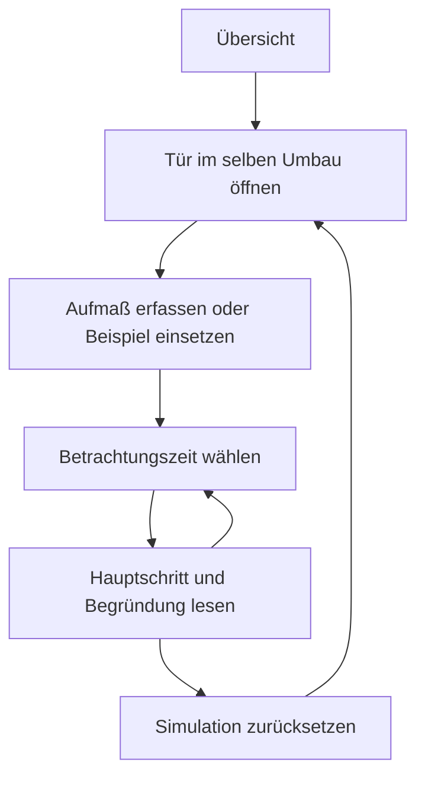
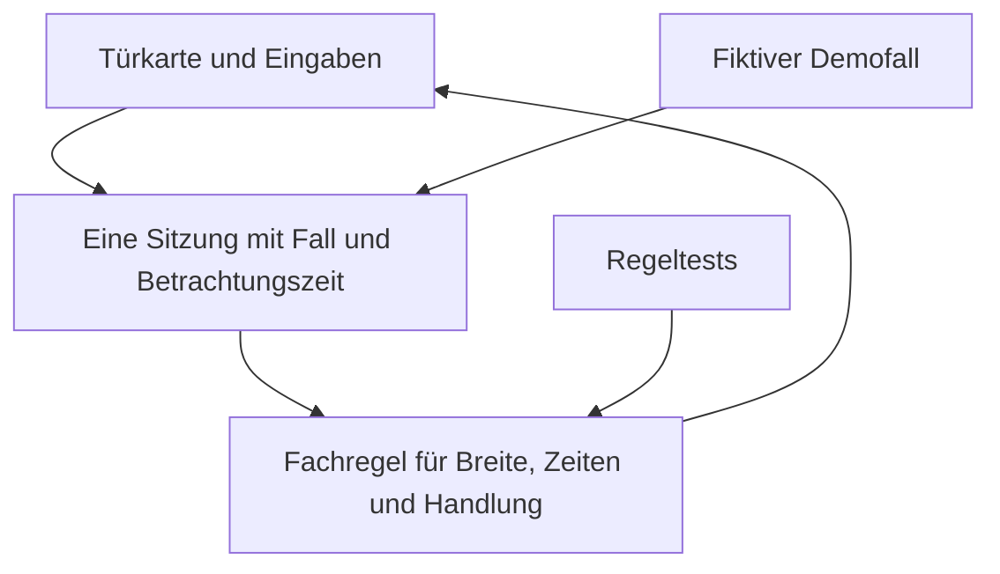

# CircularFlow – Softwareplanung für CF-UMBAU-01

**Entwurf v0.1 vom 14.11.2026 · zur Abstimmung durch Houssam und Feyrouz**

Die Planung beschreibt die erste bedienbare Türkarte im bestehenden Prototyp. Sie verbindet die Nutzeranforderungen, den Ablauf, die technische Struktur und die Inhalte der Ansichten. Maßgeblicher Verhaltensentwurf ist CF-UMBAU-01, Revision 2. Neu vorgeschlagen sind der Einstieg, die Anordnung der Karte, ihre Bedienelemente und die technische Trennung des Türfalls. Die Architektur einer produktiven Plattform bleibt eine spätere Entscheidung.

## 1. Ziel, Rollen und Umfang

**Nutzeraufgabe.** Eine Person aus Planung oder Bauleitung will vor einer Ersatzentscheidung erkennen, ob eine vorhandene Innentür samt Zarge für eine Zielöffnung desselben Umbaus fachlich weiter geprüft werden sollte. Sie muss sehen, welche Angabe fehlt, wer sie liefern kann und welcher Schritt vor oder nach der Frist sinnvoll ist.

| Rolle | Beitrag im betrachteten Ablauf |
|---|---|
| Planung oder Bauleitung | Setzt die Entscheidung ins Verhältnis zum Termin, fordert ein Aufmaß an und klärt bei Bedarf den Bestellstatus. Bedient die Karte in der Simulation. |
| Montagebetrieb | Liefert das Aufmaß der Zielöffnung mit Messbezug, Datum und Quelle. Diese Rolle erscheint auf der Karte als Zuständigkeit. |
| Fachperson | Beurteilt die tatsächliche Eignung der Variante einschließlich der weiteren technischen Kriterien. |

**Erster Lieferumfang.** Ein fiktiver Fall mit einer Innentür ohne besondere Schutzanforderungen, einem Breitenkriterium, einem Aufmaß, zwei Fristen und einem wechselnden Hauptschritt. Die App kann den Ablauf mit Beispieldaten und manueller Eingabe darstellen. Das planungsrelevante Ergebnis ist eine Handlung mit Begründung. Eine Fachperson übernimmt die technische Eignungsprüfung. Die bestehende Projektliste und Vorprüfung dienen weiterhin ihren bisherigen Fällen.

**Produktperspektive aus v0.4.** Für echte Fälle sind der wirtschaftliche Vorfilter, die vier Zeitpunkte der Informationskette und ein Vergleich mit dem heutigen Ablauf Gesprächsgegenstände. Die vier Zeitpunkte erfassen, wann ein Angebot bekannt war, die zuständige Person davon erfuhr, entschieden werden musste und eine Übergabe möglich war. Aufmaßfrist und Ersatzentscheidungsfrist sind die beiden aktiven Termine des simulierten Türfalls. Die Nutzbarkeit in der Baupraxis, notwendige Abläufe mit Fachpersonen und die Wirtschaftlichkeit sind offene Hypothesen.

## 2. Funktionale Anforderungen

| ID | Anforderung | Beobachtbares Ergebnis |
|---|---|---|
| A1 | Fall über die Übersicht öffnen. | Fall T-07 und Zielöffnung B-02 sind sichtbar. Die Kennzeichnung „Simulation mit Beispieldaten“ bleibt in der Ansicht stehen. |
| A2 | Ist-Wert und Soll mit Einheit und Herkunft zeigen. | P-02 ist als fiktives Planungsblatt erkennbar. Die Quelle des Aufmaßes und die Messstelle sind nachlesbar. Ein fehlendes Aufmaß erhält einen Textstatus. |
| A3 | Verwertbarkeit vor dem Breitenvergleich prüfen. | Nur ein endlicher, positiver Wert in mm mit korrektem Bezug, Status „gemessen“, Quelle, gültigem Messdatum und verwertbarem Eingang zählt. Fehlende, geschätzte, unzulässig bezogene und widersprüchliche Angaben bleiben offen und werden begründet. |
| A4 | Das Breitenkriterium als eigenes Ergebnis ausgeben. | 890 mm erfüllt das Kriterium. 870 mm verfehlt die Untergrenze um 15 mm. Die Grenzen 885 und 895 mm zählen zum Bereich. Höhe, Anschlag und Zustand erscheinen als offene Fachpunkte. |
| A5 | Aufmaß und Ersatzentscheidung zeitlich getrennt auswerten. | Aufmaß wird als ausstehend, überfällig, rechtzeitig oder verspätet ausgewiesen. Der Ersatztermin ist unabhängig davon offen oder verstrichen. Genau am jeweiligen Termin gilt der Vorgang noch als rechtzeitig. Ein Eingang in der Zukunft zählt zum Vergleichszeitpunkt als ausstehend. |
| A6 | Bei mehreren zutreffenden Regeln eine Handlung priorisieren. | Hauptschritt, Rolle und Begründung sind im ersten sichtbaren Bereich. Weitere zutreffende Aufgaben bleiben einzeln sichtbar. Nach der Ersatzfrist steht „Bestellstatus klären“ oben. Der Kartenstatus enthält weiterhin Breitenbefund und Aufmaßstatus. |
| A7 | Die Demonstration reproduzierbar machen. | Betrachtungszeiten sind für Europe/Berlin beschriftet. Eingangszeit und Betrachtungszeit bleiben getrennt. „Simulation zurücksetzen“ stellt den Startzustand mit offenem Aufmaß wieder her. |
| A8 | Vorhandene Vorprüfung weiter nutzbar halten. | Speichern und Wiederöffnen eines vorhandenen Vermittlungsfalls funktioniert wie zuvor. Die Türsimulation verändert dessen Daten nicht. |

**Darstellung.** Status erscheint als Text. Die Karte bleibt mit Tastatur bedienbar. Felder haben sichtbare Beschriftungen. Bei kleiner Breite stehen die Abschnitte untereinander, mit Hauptschritt und Fristen vor den Eingaben. Änderungen am Betrachtungszeitpunkt aktualisieren die Ergebnisanzeige anhand derselben Eingaben.

## 3. Nutzerablauf und Entscheidungsregeln

Die Fachregel bewertet Messbezug und Breite, Aufmaßstatus und Ersatztermin getrennt. Anschließend stellt sie die Handlungsliste in dieser Reihenfolge zusammen. Die erste zutreffende Handlung steht oben.

| Rang | Auslöser | Handlung und Zuständigkeit |
|---|---|---|
| 1 | Ersatzentscheidungsfrist verstrichen | **Bestellstatus klären** · Planung. Klären, ob Ersatz bestellt wurde und welche Optionen offen sind. |
| 2 | Aufmaßfrist liegt nach Ersatzentscheidungsfrist, oder ungültiger bzw. widersprüchlicher Eingang | **Termine klären** · Planung. Den Widerspruch im Text benennen. |
| 3 | Ersatzfrist offen, verwertbares Maß außerhalb des Sollbereichs | **Anpassung fachlich klären oder Ersatzweg vorbereiten** · Planung. |
| 4 | Ersatzfrist offen, Aufmaß überfällig oder verspätet eingegangen | **Prüfvorlauf klären** · Planung. |
| 5 | Verwertbares Aufmaß fehlt | **Rohbauöffnung B-02 messen oder Aufmaß nachreichen** · Montagebetrieb. Der Auftrag bleibt auch unter „Weiterhin offen“ sichtbar, wenn eine höher priorisierte Handlung zutrifft. |
| 6 | Breite erfüllt, Aufmaß rechtzeitig, Ersatzfrist offen und Zeitfolge widerspruchsfrei | **Variante zur fachlichen Prüfung vorlegen** · Planung. |

Ein Eingang an einem Kalendertag vor dem Messdatum ist widersprüchlich. Ein plausibles Aufmaß, das vor seiner Frist einging, behält den Status „rechtzeitig eingegangen“, wenn die Darstellung später auf einen anderen Betrachtungszeitpunkt wechselt. Der Ablauf einer Ersatzfrist allein beantwortet die Frage nach einer Bestellung nicht.

## 4. Ansichten und konkrete Inhalte

### Ansicht 1 · Übersicht des vorhandenen Prototyps

Im bestehenden Einstiegsbereich kommt eine gut sichtbare Aktion **„Tür im selben Umbau“** hinzu. Darunter steht „Prüfe, was vor der Ersatzentscheidung noch fehlt.“ Die bisherigen Testfälle und der Einstieg in die Projektübersicht folgen im bisherigen Ablauf. Für die Türkarte gibt es einen eigenen Einstieg in derselben App.

### Ansicht 2 · Tür im selben Umbau

| Reihenfolge | Sichtbarer Inhalt | Eingabe oder Aktion |
|---|---|---|
| 1. Kopf | **„Tür im selben Umbau“**, **„Simulation mit Beispieldaten“**, „Tür T-07 mit Zarge aus Raum A → Zielöffnung B-02“. | „Zur Übersicht“ |
| 2. Entscheidung | **„Nächster Schritt“**, Handlung, zuständige Rolle und ein Satz mit dem Grund. Darunter **„Weiterhin offen“** für weitere Aufgaben. | Ergebnis der aktuellen Eingaben |
| 3. Fristen | Zwei klar getrennte Zeilen mit Termin und Status. Die optionale Warnung zum Fristwiderspruch steht bei den Terminen. | **„Betrachtungszeit“** mit den vier festgelegten Zeitpunkten |
| 4. Maßvergleich | **„Rohbauöffnungsbreite B-02“**, Ist in mm oder „Aufmaß fehlt“, Soll **885–895 mm**, Herkunft **„fiktives Planungsblatt P-02 · Simulationsannahme“**. Ein Satz beschreibt die Messstelle. | Ergebnis der aktuellen Eingaben |
| 5. Aufmaß | **„Wert in mm“**, „Messbezug“, „Messstatus“, „Belegquelle“, „Messdatum“ und „Eingang bei der Planung“. Fehlermeldungen stehen am betroffenen Feld. Bei falschem Bezug nennt der Text den erwarteten Bezug. | **„Beispielaufmaß einsetzen“**, **„Simulation zurücksetzen“** |
| 6. Fachprüfung | **„Weitere Prüfpunkte“** mit Höhe, Anschlag und Zustand. Die Karte zeigt den Breitenbefund und die Rolle der Fachperson. | Lesebereich |

**Gestaltungsvorschlag.** Am Desktop stehen Entscheidung und Fristen nebeneinander. Der Maßvergleich steht links neben der Aufmaßeingabe. Auf schmalen Geräten folgt alles der Reihenfolge der Tabelle. Die Ansicht hat eine klare Hauptüberschrift und verwendet für die Status nur die Farben und Komponenten des vorhandenen Prototyps, soweit sie sich verständlich einsetzen lassen.

**Feste Demo-Daten.** Aufmaß bis **18.11.2026, 16:00 Uhr**. Ersatzentscheidung bis **19.11.2026, 12:00 Uhr**. Betrachtungszeiten **18.11., 14:00** und **15:30 Uhr**, **19.11., 09:00 Uhr** und **20.11., 09:00 Uhr**, jeweils Europe/Berlin. Die Beispieltaste setzt 890 mm, den Bezug P-02, Status „gemessen“, eine fiktive Aufmaßnotiz, Messdatum 18.11. und Eingang 18.11., 15:00 Uhr. Die Betrachtungszeit bleibt dabei eine eigene Auswahl. Beim Start ist das Aufmaß leer.

### Bestehende Ansichten · Projekte und Vorprüfung

Die Projektansicht bietet die vorhandenen Angebots- und Bedarfsprojekte. Die Vorprüfungsansicht öffnet die bisherigen Vermittlungsfälle mit ihren Eingaben und Ergebnissen. Die neue Türkarte wird über die Übersicht erreicht und bearbeitet ihren Fall separat. Diese beiden vorhandenen Ansichten sind Teil der Browserabnahme.

### Perspektive für eine spätere Produktplanung

| Mögliche Ansicht | Aufgabe und Inhalt |
|---|---|
| Projektübersicht | Umbaukontext, verfügbare Bauteile, Zielorte und Entscheidungen mit ihren Terminen. |
| Bauteilansicht | Identität, Aufmaß, Quelle, Zustand und vorhandene Nachweise. Für jede Angabe sichtbar machen, wie sie erfasst und bestätigt wurde. |
| Entscheidungsansicht | Konkrete Zielöffnung, Anforderungen, belegte Kriterien, offene Punkte, Rollen und Fristen. |
| Fachprüfung | Unterlagen und offene Fachfragen für die zuständige Person. Bedarf an einer eigenen Ansicht und Freigabelogik anhand echter Abläufe prüfen. |

Diese Übersicht dient der Einordnung der Türkarte. Detailseiten und technische Infrastruktur eines Piloten werden aus dem tatsächlichen Arbeitsablauf abgeleitet.

## 5. Architekturentwurf für die erste Version

**Beobachteter Stand.** Am 14.11.2026 in Entwurfs-PR #1 am Commit f640e2b eingesehen: Die statische Anwendung verwendet HTML, CSS und JavaScript-Module. `prototype/dist/app.mjs` steuert die Ansichten und speichert vorhandene Fälle lokal im Browser. `prototype/dist/rules.mjs` bewertet die bisherige Vermittlungsvorprüfung. Der Türfall benötigt zusätzlich Uhrzeiten, einen Messbezug und eine separate Handlungspriorität.

**Architekturvorschlag.** Die Türkarte bindet sich an die vorhandene App-Navigation an. Ihre Daten liegen für diese Simulation im Arbeitsspeicher der Seite. Eine reine Auswertungsfunktion erhält den Fall, die Aufmaßangabe und den Betrachtungszeitpunkt als Eingaben. Sie liefert den Breitenbefund, beide Zeitstände, Warnungen und die geordnete Handlungsliste. Die Oberfläche stellt diese Ergebnisse dar. Fachlogik und Texte in der Oberfläche haben damit dieselbe Quelle für das Ergebnis. Die Uhrzeit wird aus den explizit übergebenen Werten bestimmt. Die vorhandene Vermittlungsvorprüfung hat ihren eigenen Auswertungsweg und Speicher.

| Datengruppe | Eingaben | Wofür sie gebraucht werden |
|---|---|---|
| Demofall | Fall-ID, Tür samt Zarge, Herkunftsort, Zielöffnung | Gemeinsamer Bezug für die Anzeige |
| Anforderung | Unter- und Obergrenze in mm, Bezug P-02, Messstelle und Quelle, Kennzeichnung als Annahme | Sollvergleich und Erklärung des Messauftrags |
| Aufmaß | Wert, Einheit, Messbezug, Status, Quelle, Messdatum, Ankunftszeit | Verwertbarkeit und Breitenbefund sowie Eingang relativ zur Frist |
| Zeitstand | Aufmaßfrist, Ersatzentscheidungsfrist, Betrachtungszeit | Getrennte zeitliche Auswertung ohne Abhängigkeit von der Geräteuhr |
| Ergebnis | Breitenbefund mit Begründung, Zeitstände, Warnungen, Handlungen mit Rollen | Anzeige auf der Karte und überprüfbare Abnahme |

**Offene Architekturfragen für einen Piloten.** Erhebung und Eigentümerschaft der Daten, Freigaberollen, Speicherung, Mehrbenutzerzugriff und Schnittstellen klären, sobald ein Praxisfall sie verlangt. Die erste Version hat eine statische Auslieferung und das Berechnungsmodell im Browser.

## 6. Abnahme und Reihenfolge der Umsetzung

| Vorführung oder Prüfung | Erwartetes Verhalten |
|---|---|
| Startzustand am 18.11., 14:00 Uhr | Breite offen. Aufmaß ausstehend. Messauftrag an den Montagebetrieb. |
| Gültige 890 mm, eingegangen am 18.11., 15:00 Uhr, betrachtet um 15:30 Uhr | Breite erfüllt. Aufmaß rechtzeitig. Planung legt zur Fachprüfung vor. |
| Dieselbe Eingabe betrachtet am 20.11., 09:00 Uhr | Breite erfüllt. Aufmaß weiterhin rechtzeitig. Hauptschritt „Bestellstatus klären“. |
| Abweichendes oder ungültiges Maß, abweichende und ungültige Zeiten | Ergebnisse folgen den Fällen 03–13 aus Revision 2, einschließlich Grenzwerten, widersprüchlicher Zeitfolge, Rücksprung und weiterhin offenen Aufgaben. |
| Browserablauf | Einstieg öffnen, Aufmaß erfassen, Zeit vor und zurück stellen, zurücksetzen. Danach einen bisherigen Vermittlungsfall öffnen und seine Bearbeitung prüfen. |

Die detaillierten Fälle 01–13 aus Revision 2 sind die Vorlage für die fachlichen Regeltests. Fall 14 ist die Browserprüfung. Die 13 bestehenden Regeltests werden zusätzlich erneut ausgeführt. Für den Praxistest wird separat gefragt, ob eine Person aus Planung oder Bauleitung die nächste Handlung samt Rolle ohne Erklärung benennen kann. Eine Vorführung mit Beispieldaten liefert einen Funktionsnachweis für den Ablauf.

**Reihenfolge nach Abstimmung.** Zuerst die Regeln und ihre Prüffälle im bestehenden Projekt verorten. Dann Einstieg, Karte, Eingaben und Rücksetzen anschließen. Zum Schluss Regeltests und Browserablauf durchführen. Die Abstimmung umfasst die erste Nutzerrolle, die zwei Ansichten und die vorgeschlagene technische Trennung. Die endgültige Farbauswahl und Feinabstände sind nachrangig und lassen sich an einem Klickentwurf prüfen.

## 7. Prüfauftrag für Claude Code

In **Claude Code → Plan** im vorhandenen CircularFlow-Repository ausführen. Dieses Dokument und **CF-UMBAU-01, Revision 2** mitgeben.

> Prüfe diesen Plan gegen den vorhandenen Prototyp im Entwurfs-PR #1. Lies die in Revision 2 genannten Projektdateien. Prüfe die Annahmen zur Navigation, zur getrennten Auswertung, zu den Daten und zur Browserabnahme. Gib einen konkreten Dateiplan und eine Reihenfolge der Arbeitsschritte zurück. Nenne Widersprüche und Entscheidungen, die das Team vor der Umsetzung treffen muss. Arbeite im Planmodus und liefere die Prüfung als Text.

**Quellen und Status**

- [CF-UMBAU-01, Revision 2 vom 14.11.2026](https://chatgpt.com/library?file_id=libfile_c234534bfa748191a86ff749533a779d&account_id=personal) · Projektquelle, lokal gelesen.
- [CircularFlow, Produktfassung v0.4](https://chatgpt.com/library?file_id=libfile_50315bacaf0c8191aef34b9611593cb2&account_id=personal) und [Praxistest-Paket](https://chatgpt.com/library?file_id=libfile_4c99813106908191848ae66be925ac35&account_id=personal) · angehängte Projektquellen vom 14.11.2026, Vorschläge von Claude.
- [Entwurfs-PR #1](https://github.com/sammo3332/CircularFlow/pull/1) · README, bestehende Navigation, Speicherung und Regelstruktur am Referenzcommit f640e2b am 14.11.2026 eingesehen.
- [Claude Code Desktop, Sitzungs- und Berechtigungsmodi](https://code.claude.com/docs/en/desktop#permission-modes) · Anbieterdokumentation am 14.11.2026 gelesen.
