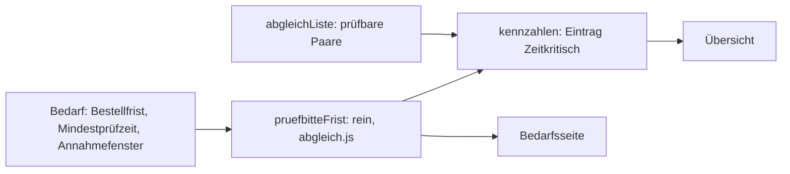

# Plan · Frist „Prüfbitte spätestens“

| | |
|---|---|
| Dokumentversion | 1.1 vom 18.11.2026. Entwurf der Planung (`cf-planung`), von der Koordination um Abschnitt 9 ergänzt (Entscheidungen). Nach der ersten unabhängigen Prüfung berichtigt: Ausgangscommit, Eintragsform, Wortlaut zum Fenster, Beispieldaten BD-23 (E10), Liste der Nachführung. |
| Status | Plan. Der Auftraggeber hat die Umsetzung der kleinsten sinnvollen Verbesserung am 17./18.11.2026 beauftragt (Abschnitt 9). Umsetzung nur auf dem getrennten Branch `codex/plattform-entwicklung-20261118`. Kein Merge, keine Veröffentlichung, keine Änderung der geteilten Vorschau. |
| Branch | Planung auf `codex/plattform-v1`. Umsetzung durch `cf-entwicklung` auf `codex/plattform-entwicklung-20261118` (Ausgangscommit `23dc050`, der Commit dieses Plans). `plattform/` und `prototype/` bleiben auf `codex/plattform-v1` unverändert. |
| Ausgangscommit | `da85183` (HEAD von `codex/plattform-v1`, aus `.git` gelesen). Zeilenangaben gelten für `da85183`. Dass sich am Anwendungscode seit `2121b92` nichts geändert hat, steht in Plan Restmenge 1.1 und Fallakte 1.3. Die Koordination hat es am 18.11.2026 nachgeprüft: `git diff --stat 2121b92 23dc050 -- plattform prototype` zeigt nur `plattform/README.md` (2 Zeilen). |
| Pitch-Stand | bleibt festgehalten: Vorschau Version 2 (`1794826502-00b9`), Code `2121b92`. Dieser Plan ändert daran nichts. |
| Maßgeblich | Produktbrief v0.2 (08.11.2026). Er nennt diese Frist nicht (Fallakte §9). Der Plan erweitert Fassung 2 (Demo-Entwurf) nur auf dem Entwicklungsbranch; über Merge und Vorschau entscheidet das Team. |
| Grundlage | Fallakte CF-PILOT-01 1.3 (§1, §5, §9, §11) · Produktideen 1.3 (§3, B2) · plattform-v2 2.0 (§3, §4, §10) · Plan Restmenge 1.1 · CF-UMBAU-01 Rev. 2 (nur Fristbegriffe, Z. 66–98) · Teil A (Priorisierung) |
| Anlass | Pitch Folie 2 „Spätestens am 5. Februar die Prüfung anfragen“. Die Vorschau zeigt diesen Tag nicht als Frist (Produktideen §1). |

## Wahl in drei Sätzen

Von den zwei Kandidaten ist „Prüfbitte spätestens“ die kleinste: vier App-Dateien, eine neue Testdatei und eine Skriptanpassung, ohne Änderung an Abgleichregel, Vorgangsstatus, Daten oder Speicher, während die Restmenge laut Plan 1.1 neun Dateien, zehn Abnahmekriterien und sechs offene Teamfragen (F1–F6) mitbringt.
Sie ist vollständig beschreibbar und hinterlässt keinen halben Stand, weil sie nur liest, was der Abgleich schon berechnet, und jede Anzeige auch ohne die Restmenge sinnvoll bleibt.
Sie schließt die Lücke, die Pitch (Folie 2), Fallakte (§5 Variante 2) und der externe Hinweis übereinstimmend nennen, setzt aber voraus, dass das Team die Reihenfolge vom 16.11.2026 („Restmenge zuerst“) für diese Umsetzung aufhebt (Frage 1).

## 1. Auftrag

**Nutzerrolle (Rollenannahme, kein Praxisbefund, Produktbrief v0.2):** Planung auf der Bedarfsseite, im Pilot „Planung UAK“; die Bauleitung liest mit.
**Nutzerproblem (Beobachtung aus der Nachrechnung, Fallakte §1, §5):** Mit 14 Tagen Mindestprüfzeit ist der 05.02.2027 der letzte Tag für die Prüfbitte zur Bestellfrist 19.02.2027. Die Vorschau nennt diesen Tag nirgends. „Zeitkritisch“ zeigt die Bestellfrist erst ab 13.02. (7-Tage-Fenster, `kennzahlen.js` Z. 83, 101). Bei jeder Prüfzeit über 7 Tage kommt der Hinweis zu spät; die Beispielbedarfe haben 10 und 14 Tage.
**Konkreter Ablauf:** (1) Die Planung öffnet die Übersicht und sieht unter „Zeitkritisch“ „Prüfbitte spätestens · BD-24“ mit Tag und Rechnung. (2) Ein Klick öffnet die Bedarfsseite mit derselben Angabe und den Angeboten. (3) Ein Klick auf ein prüfbares Angebot öffnet den Abgleich, dort „Prüfbitte anlegen“ (besteht). (4) Sobald ein Vorgang läuft, entfällt der Eintrag.
**Gewünschtes Verhalten:** Für jeden Bedarf ohne laufenden Vorgang, zu dem mindestens ein Paar „Weiter prüfen“ oder „Knapp“ ergibt, steht in den 7 Tagen bis zum Fristende (Fristtag, 23:59) „Prüfbitte spätestens“ unter „Zeitkritisch“. Die Bedarfsseite nennt den Tag, seine Rechnung und die Herkunft („geschätzt“) der Angaben. Die Frist ist der letzte Tag, an dem der Abgleich das Paar noch als prüfbar zeigt; danach sagt er „Für diese Entscheidung zu spät“.
**Ausgeschlossen:**
- Versand, Erinnerung, Kontaktaufnahme (Produktideen §3: zuerst ohne Versand lösen).
- Änderung von Abgleichregel, Türregel (Aufmaßfrist, Ersatzentscheidung; der Sollbereich von B-02 bleibt Simulationsannahme), Bodenregel, Vorgangsstatus und Vorgangsfristen.
- Neue Eingabefelder, neue gespeicherte Daten und jede Änderung an `daten.js` (sonst ändert sich die Startbedingung).
- Zeile auf der Abgleichseite, neue Spalte in der Bedarfsliste, Wochenend- und Feiertagsregel.
- Restmenge, Frist für Vorgänge im Status „Angelegt“ (Frage 3), Preise, CO₂- und Einsparwerte.

**Offene Annahmen:** Die 14 Tage Prüfzeit bleiben Simulationsannahme (Fallakte A5, §11). Das Team bestätigt den Begriff „Prüfbitte spätestens“ (Frage 2). Es wird keine Wirkung auf reale Entscheidungen behauptet.

**Abnahmekriterien** (Tests siehe 5, Browserläufe siehe 6):

| Nr. | Beobachtbares Ergebnis | Ansicht oder Fachregel | Quelle | Prüfung |
|---|---|---|---|---|
| PS-1 | Die Regel nennt für BD-24 (Pilot) den 05.02.2027, für BD-22 den 21.03.2027, für BD-23 den 13.11.2026. | `pruefbitteFrist` | Fallakte §9; Produktbrief (Regel) | T1, T2, T7 |
| PS-2 | Bis zum Fristtag ergibt der Abgleich „Weiter prüfen“ oder „Knapp“, am Tag danach „Für diese Entscheidung zu spät“. | Fachregel und Abgleich | plattform-v2 §3 | T4 |
| PS-3 | „Zeitkritisch (7 Tage)“ zeigt „Prüfbitte spätestens“ je Bedarf mit prüfbarem Paar, solange das Fristende (Fristtag, 23:59) höchstens 7 Tage nach der Projektzeit liegt (BD-24: ab dem 29.01.2027, 23:59; am 29.01.2027 um 09:00 noch nicht, am 30.01.2027 um 09:00 ja). | Übersicht | Fallakte §9; Produktideen §3 | T5, T7, T8, BA-3 |
| PS-4 | Höchstens ein Eintrag je Bedarf, nie überfällig, keiner bei laufendem Vorgang, ohne prüfbares Paar oder nach dem Fristtag. | Übersicht | Entscheidung E2 | T5, T6, BA-5 |
| PS-5 | Fehlende oder ungültige Angaben ergeben keinen Eintrag; die Bedarfsseite zeigt „nicht berechenbar“ mit Grund. | Bedarfsseite | plattform-v2 §3 | T3, T8, BA-2 |
| PS-6 | Eine als „geschätzt“ gekennzeichnete Angabe steht als „(geschätzt)“ im Eintrag und als Chip auf der Bedarfsseite. | Übersicht, Bedarfsseite | Produktbrief A3; externer Hinweis | T1, T2, T5, T8, BA-2, BA-3 |
| PS-7 | Die Bedarfsseite zeigt Tag und Rechnung, bei einem Tag vor dem Stichtag „verstrichen“. | Bedarfsseite | Entscheidung E2 | T8, BA-2 |
| PS-8 | Abgleichregel, Vorgangsstatus, Beispieldaten und Speicher bleiben unverändert; alle bestehenden Tests bleiben grün. | gesamt | CLAUDE.md | T9 |
| PS-9 | Am Demo-Stichtag bleibt alles wie im Pitch-Stand (Abschnitt 7). | Übersicht | pitch-ablauf | T6, BA-1 |
| PS-10 | Kein neuer Text enthält Preise, CO₂-, Kosten- oder Einsparwerte oder eine Eignungsaussage. | alle neuen Texte | AGENTS.md; Produktbrief A5 | T8 |
| PS-11 | Bedienbar per Tastatur, kein seitliches Scrollen bei 390 × 844. | Übersicht, Bedarfsseite | plattform-v2 §6 | BA-4 |
| PS-12 | Die Pilot-Nachrechnung läuft grün und nennt „Prüfbitte spätestens“ ab 30.01.2027 sowie den letzten prüfbaren Tag 05.02.2027. | `cf-pilot-01-simulation.mjs` | Fallakte §10 | T10 |

## 2. Regel

**2.1 Formel** (`pruefbitteFrist(bedarf)`, rein, ohne DOM und ohne Systemuhr)
- Eingaben: `bestellfrist` (Text `JJJJ-MM-TT`; fehlt sie, der Tag aus `fristen.ersatz`, wie `pruefeZeit` Z. 107), `annahmeBis` (Text `JJJJ-MM-TT`, darf fehlen), `pruefzeitTage` (ganze Zahl 0 bis 365, auch als Ziffernfolge), `belegt.bestellfrist`, `belegt.pruefzeitTage`, `belegt.annahme` (`belegt` oder `geschaetzt`).
- Grenze G = der frühere der Tage Bestellfrist und Ende des Annahmefensters (fehlt das Ende oder gilt Gleichstand: die Bestellfrist). **Prüfbitte spätestens = G minus Mindestprüfzeit**, in Kalendertagen.
- Bedeutung: der letzte Prüfbeginn P, bei dem der Abgleich noch „Weiter prüfen“ oder „Knapp“ liefert. Der Abgleich prüft Prüfende E = P + Prüfzeit gegen Bestellfrist und Annahmeende (`abgleich.js` Z. 146–152). Am Fristtag ist E gleich G („Knapp“, Reserve 0, Z. 174), einen Tag später „zu spät“. Das folgt der Produktbrief-Regel: Eingang plus Mindestprüfzeit darf auf den Fristtag fallen.
- Zeit: Kalendertage der Berliner Wanduhrzeit. `zeit.js` rechnet mit Zeichenketten über `Date.UTC`, ohne Gerätezeitzone, die Zeitumstellung hat keinen Einfluss. Das Fristende ist 23:59 (`tagesende`, wie bei der Bestellfrist). Die Frist wird nicht gerundet; die Restzeit „noch 6 Tg. 14 Std.“ rundet ab (`abstand`, `tage` = floor).
- Rückgabe: `{ status: 'ok'|'fehlt'|'klaerung', tag, grenze: 'bestellfrist'|'annahme', grenzTag, pruefzeitTage, geschaetzt: [Namen wie im Abgleich], fehlend: [...], klaerung: [...], text }`. Reihenfolge der Status wie im Abgleich: erst `klaerung`, dann `fehlt`, dann `ok`.
- Eintrag unter „Zeitkritisch“: je Bedarf höchstens einer, wenn `status === 'ok'`, mindestens ein Paar des Bedarfs in `abgleichListe(ctx)` „weiter“ oder „knapp“ ist (die Liste lässt Bedarfe mit laufendem Vorgang aus) und `tagesende(tag)` zwischen Stichtag und Stichtag plus 7 Tage liegt. Nie überfällig.

**2.2 Randfälle** (Entscheidungen des Koordinators, mit Begründung)

| Fall | Ergebnis | Begründung |
|---|---|---|
| Mindestprüfzeit unbekannt (`null`, leer, fehlt) | `fehlt`, kein Eintrag; Bedarfsseite „nicht berechenbar“ | Ohne Prüfzeit wird nicht geraten; wie „Angaben fehlen“ im Abgleich |
| Mindestprüfzeit 0 | gültig; Frist = Bestellfrist; der Eintrag steht am selben Tag wie die Bestellfrist, davor in der Liste | 0 ist laut plattform-v2 §3 gültig; keine Sonderregel |
| Mindestprüfzeit oder Datum ungültig (−1, 366, 1,5, „abc“, 30.02.) | `klaerung`, kein Eintrag; Sätze wie im Abgleich | Widerspruch geht vor (plattform-v2 §3) |
| Bestellfrist fehlt | `fehlt`, kein Eintrag | wie oben |
| Ende des Annahmefensters vor der Bestellfrist | der frühere Tag gilt (`grenze: 'annahme'`) | Sonst nennt die Zeile einen Tag, an dem der Abgleich schon „zu spät“ sagt (T4: 9 Tage Abweichung) |
| Bedarf mit laufendem Vorgang (alle Status außer „ungeeignet“ und „abgebrochen“, auch „Angelegt“, „übergeben“) | kein Eintrag | `abgleichListe` und `bedarfBelegt` (`vorgang.js` Z. 89–92) |
| Frist liegt vor dem Stichtag | alle Paare „zu spät“, kein Eintrag; Bedarfsseite „verstrichen“ | Verhindert, dass BD-23 (13.11.2026) die Startbedingung ändert |
| Frist am Stichtag | Paar „Knapp“; Eintrag mit 0 Tagen und Restzeit in Stunden | Der Grenztag zählt als rechtzeitig (Produktbrief, Rev. 2) |
| Menge nicht gedeckt (Teilmenge) | zählt wie im Abgleich als prüfbar; die Zeile sagt nichts zur Menge | Eine Definition von „prüfbar“ (Übersicht, Bedarfsliste); keine neue Fachaussage |
| Doppelboden | gleiche Regel; die Beispielbedarfe haben keine Prüfzeit, also „nicht berechenbar“ | Der Plan liest nur den Abgleich |
| Kein Angebot | kein Eintrag; die Bedarfsseite zeigt den Tag trotzdem | Die Frist ist eine Eigenschaft des Bedarfs |

**2.3 Abgrenzung (Rev. 2, plattform-v2 §3):** Die **Aufmaßfrist** (Türregel, Messung an der Zielöffnung) und die **Ersatzentscheidungsfrist** (Türregel `replaceDeadline`; beim Bedarf die Bestellfrist) bleiben unverändert und gehören zu Vorgängen. „Prüfbitte spätestens“ ist keine von beiden, gehört zum Bedarf und dokumentiert weder eine Prüfbitte noch eine Bestellung (Rev. 2: Der Termin dokumentiert keine ausgelöste Bestellung).

## 3. Anzeige

**3.1 Seiten**

| Seite (Route) | Zweck | Änderung |
|---|---|---|
| Übersicht (`#uebersicht`) | Fristen der nächsten 7 Tage | neue Zeile im Block „Zeitkritisch (7 Tage)“; die Kopfzahl zählt mit |
| Bedarfsseite (`#bedarf-<projekt>-<id>`) | Angaben und Angebote eines Bedarfs | neue Zeile im Block „Angaben“ nach „Annahmefenster“ |
| unverändert | Bedarfsliste, Paarliste, Abgleichseite, Entscheidungsseite, Arbeitsliste, Karte, Pass, Katalog, Erfassen | – |

**3.2 Wortlaut** (alle neuen Texte; „Mindestprüfzeit“ wie im Formular)

| Text | Ort (Datei, Funktion) |
|---|---|
| `Prüfbitte spätestens` | Name der Frist: Konstante `FRIST_PRUEFBITTE` in `abgleich.js`, genutzt in `kennzahlen.js`; fett in `uebersicht.js` `zeitkritisch()`; Beschriftung in `bedarfe.js` `bedarfDetail()` |
| `Bedarf · 4 prüfbare Paare · Bestellfrist 19.02.2027 minus 14 Tage Mindestprüfzeit (geschätzt)` | Zeitkritisch, kleine Zeile (`detail`, gebaut in `kennzahlen.js`). Varianten: „1 prüfbares Paar“; „Ende des Annahmefensters 10.02.2027 minus …“; ohne „(geschätzt)“; „(geschätzt)“ auch hinter Bestellfrist oder Annahmefenster, wenn diese geschätzt sind |
| `05.02.2027` mit Chip `geschätzt` | Bedarfsseite, Wert; der Chip steht nur, wenn eine genutzte Angabe geschätzt ist |
| `Bestellfrist 19.02.2027 minus 14 Tage Mindestprüfzeit (geschätzt)` | Bedarfsseite, kleine Zeile 1 (`text` der Funktion) |
| `In den 7 Tagen davor steht sie unter „Zeitkritisch“, solange ein Angebot prüfbar ist und kein Vorgang läuft.` | Bedarfsseite, kleine Zeile 2, nur wenn nicht verstrichen |
| Chip `verstrichen` | Bedarfsseite, wenn der Tag vor dem Stichtag liegt; dann entfällt Zeile 2 |
| `nicht berechenbar` mit `Bestellfrist fehlt. Mindestprüfzeit fehlt.` oder `Die Bestellfrist enthält ein ungültiges Datum.` oder `Die Mindestprüfzeit muss eine ganze Zahl von 0 bis 365 Tagen sein.` oder `Das Ende des Annahmefensters enthält ein ungültiges Datum.` | Bedarfsseite anstelle des Datums |

**3.3 Zustände und Bedienung**
- Leer: Gibt es keine solche Frist, bleibt der bestehende Text „Keine Frist in den nächsten 7 Tagen nach dem Stichtag der Demo (…)“.
- Fehler: kein neues Formular und keine neue Meldung. Fehlende oder ungültige Angaben zeigt die Bedarfsseite als „nicht berechenbar“ mit Grund; behoben wird das über „Bedarf ergänzen“ (besteht).
- Erfolg: Der Eintrag erscheint, und die Kopfzeile zählt eine Frist mehr („5 Fristen“).
- Navigation: Zeile → `#bedarf-<projekt>-<id>` (besteht) → Zeile im Block „Angebote derselben Gruppe“ → Abgleichseite → „Prüfbitte anlegen“. Keine neue Route.
- Tastatur: Der Eintrag ist ein Link in der bestehenden Liste (Tab, Enter); der Fokus liegt nach der Navigation im Inhalt wie bisher. Neue Angaben stehen als Text und Chip mit Wort, nicht nur als Farbe.
- Schmal (390 × 844): Die kleine Zeile bricht um, es gibt kein seitliches Scrollen. Eine CSS-Änderung ist nicht geplant.

**3.4 Skizze** (Beispiel aus BA-3)

```text
Übersicht · Zeitkritisch (7 Tage)                           5 Fristen · Überfälliges zuerst
[noch 6 Tg. 9 Std.]  Prüfbitte spätestens · BD-24 · Fristtest                Di 24.11., 23:59
                     SB Bedarf · 2 prüfbare Paare · Bestellfrist 30.11.2026 minus 6 Tage Mindestprüfzeit (geschätzt)
Bedarfsseite · Angaben          Prüfbitte spätestens   24.11.2026 [geschätzt]
                                Bestellfrist 30.11.2026 minus 6 Tage Mindestprüfzeit (geschätzt)
                                In den 7 Tagen davor steht sie unter „Zeitkritisch“, solange ein Angebot prüfbar ist und kein Vorgang läuft.
```

## 4. Betroffene Stellen, Datenfluss, Architektur

| Datei | Funktion, Zeilen (`da85183`) | Änderung |
|---|---|---|
| `plattform/app/abgleich.js` | neu zwischen `entfernung` (Z. 181–186) und „Abgleich“ (Z. 188); nutzt `fakt`, `pruefzeit`, `tagNr`, `tagText`, `tage`, `datum` (Z. 5, 37–52) | `export const FRIST_PRUEFBITTE`, `export function pruefbitteFrist(bedarf)` (rein, ca. 30 Zeilen). `pruefeZeit` und `abgleich` bleiben unverändert. |
| `plattform/app/kennzahlen.js` | Import Z. 7; Block „Zeitkritisch“ Z. 82–105; `pruefbarePaare` Z. 69 | Import ergänzen. Vor der Schleife der Bestellfristen (Z. 98) die Paare nach Bedarf gruppieren und je Bedarf einen Eintrag `{ art: 'bedarf', projekt, id, ref, name, at, ueberfaellig: false, ton: 'warn', tage, pruefbarePaare, detail }` einfügen (ca. 12 Zeilen). Das Einfügen vor der Bestellfrist ordnet bei gleicher Zeit die Prüfbitte zuerst. `projekt`, `id` und `ref` braucht `zeile()` in `uebersicht.js` für Titel und Link, wie bei der Bestellfrist. |
| `plattform/app/ansichten/uebersicht.js` | `zeitkritisch()` Z. 24–43, kleine Zeile Z. 34 | `f.detail` (mit `esc`) statt „Bedarf, zum Bedarf“, wenn vorhanden |
| `plattform/app/ansichten/bedarfe.js` | `bedarfDetail()` Z. 70–110, Block „Angaben“ Z. 83–95, nach „Annahmefenster“ Z. 90; `paare` Z. 72 | Import `pruefbitteFrist`; Zeile `angabe('Prüfbitte spätestens', …)` über eine Hilfsfunktion (ca. 12 Zeilen); `ctx.at` für „verstrichen“ |
| `plattform/test/pruefbittefrist.test.mjs` | neu | Tests T1 bis T8 (ca. 120 Zeilen) mit Hilfen aus `_hilfe.mjs` |
| `docs/pilot/cf-pilot-01-simulation.mjs` | Z. 131–136 (Bestellfrist erscheint ab 13.02.), Kopfkommentar Z. 1–7 | Filter `f.name === 'Bestellfrist'`. Neu: erster Tag „Prüfbitte spätestens“ = 30.01.2027 und Gleichlauf mit `letzterPruefbarerTag` (Z. 127). Ohne Änderung bricht das Skript an Z. 136 ab, weil der erste Eintrag für BD-24 dann der 30.01. statt des 13.02. wäre. |
| unverändert | `daten.js`, `zustand.js`, `regeln.js`, `vorgang.js`, `main.js`, `ansichten/abgleich.js`, `entscheidung.js`, `vorgangsteil.js`, `styles.css`, `prototype/` | – |
| Dokumente (Hauptsitzung, nach der Abnahme) | `docs/pilot/CF-PILOT-01-fallakte.md` §1, §5, §9, §11 · `docs/produktideen-aus-dem-pitch.md` B2 · `docs/plattform-v2.md` §4 · `docs/plan-restmenge.md` §1 · `plattform/README.md` (Dateitabelle, Stand) · Folienplan A3 nur bei neuer Vorschau | Stand „Kandidat“ nachführen: auf dem Entwicklungsbranch umgesetzt, nicht in der Vorschau, nicht freigegeben. Pilot-Klickpfad Schritt 6: Prüfzeit als „geschätzt“ kennzeichnen. `docs/produktbrief.md` und `docs/pitch-ablauf.md` bleiben unverändert (der Produktbrief nur mit ausdrücklicher Freigabe des Teams). |



**Datenmodell und Zustand:** Es gibt keine neue gespeicherte Größe (Speicherschema Version 1 bleibt), kein Ereignis und keine Zustandsänderung. Die Frist wird bei jedem Rendern aus Bedarf, Paaren und Projektzeit berechnet. Das Eintragsobjekt in `kennzahlen` existiert nur zur Laufzeit.
**Abhängigkeiten:** Gleichlauf mit `pruefeZeit` (geschützt durch T4); der Block „Zeitkritisch“, den die Restmenge später ebenfalls ändert; das Pilot-Skript; die Freigabe (Frage 1).
**Ablauf (CLAUDE.md, agenten-start):** `cf-entwicklung` setzt Fachkern und Tests (T1–T7) zuerst um, dann Anzeige (T8) und Skript (T10). `cf-review` prüft lesend gegen diesen Plan. `cf-test` führt auf demselben Codestand die Tests und BA-1 bis BA-5 aus. Keine Hooks, keine parallelen Läufe.

## 5. Tests

Alle Sollwerte habe ich von Hand aus dem Code abgeleitet und nicht ausgeführt. `cf-entwicklung` führt sie aus und meldet jede Abweichung als Befund, statt den Sollwert anzupassen. Fixtures: **BD-24** = Pilotbedarf (Projekt UAK, Innentüren, 6 Stk, `bestellfrist 2027-02-19`, `pruefzeitTage 14` mit `belegt.pruefzeitTage 'geschaetzt'`, Annahme 08.–12.03.2027, angelegt 11.01.2027). **T-13** = Pilotangebot (LH, 6 Stk, verfügbar ab 05.03.2027, erfasst 19.01.2027 15:00). Beide kommen in `p.bedarfe` und `p.erfassungen`; die Beispieldaten bleiben unverändert.

| Nr. | Test und Eingabe | Erwartung | Anf. |
|---|---|---|---|
| T1 | `pruefbitteFrist(BD-24)` | `status 'ok'`, `tag '2027-02-05'` (19.02. − 14 Tage), `grenze 'bestellfrist'`, `grenzTag '2027-02-19'`, `geschaetzt ['Mindestprüfzeit']`, `text` „Bestellfrist 19.02.2027 minus 14 Tage Mindestprüfzeit (geschätzt)“ | PS-1, PS-6 |
| T2 | `pruefbitteFrist` für BD-22 und BD-23 aus `daten.js` | BD-22: `2027-03-21` (31.03. − 10), `grenze 'bestellfrist'` bei Gleichstand mit Annahmeende 31.03., „… 31.03.2027 minus 10 Tage Mindestprüfzeit (geschätzt)“. BD-23: `2026-11-13` (27.11. − 14), ohne „(geschätzt)“ | PS-1, PS-6 |
| T3 | Randfälle: Prüfzeit `0`, `'1'`, `null`, `''`; Bestellfrist `null`; beides fehlt; Prüfzeit `-1`, `366`, `1.5`, `'abc'`; Bestellfrist `2027-02-30`; Annahmeende `2027-02-10` bei Frist 19.02. und 14 Tagen | `0` → `2027-02-19`, „… minus 0 Tage …“; `'1'` → „1 Tag“; `null` oder `''` → `fehlt`, `fehlend ['Mindestprüfzeit']`; ohne Bestellfrist → `['Bestellfrist']`; beides → beide; ungültige Prüfzeit → `klaerung` mit „Die Mindestprüfzeit muss eine ganze Zahl von 0 bis 365 Tagen sein.“; `2027-02-30` → `klaerung` mit „Die Bestellfrist enthält ein ungültiges Datum.“; Annahmeende → `2027-01-27`, `grenze 'annahme'`, „Ende des Annahmefensters 10.02.2027 minus 14 Tage Mindestprüfzeit“ | PS-1, PS-5 |
| T4 | Gleichlauf: `kleinKontext([T-13], [BD-24], '<Tag>T16:00')` für jeden Tag vom 19.01. bis 22.02.2027 | Der Abgleich ist „Weiter prüfen“ oder „Knapp“ genau bis einschließlich 05.02. 04.02.: „Weiter prüfen“ (Reserve 1). 05.02.: „Knapp“ („Prüfende 19.02.2027 liegt am Tag der Bestellfrist 19.02.2027.“). 06.02.: „Für diese Entscheidung zu spät“ („Prüfende 20.02.2027 liegt 1 Tag nach der Bestellfrist 19.02.2027.“). Zweite Reihe mit Annahmeende 10.02.2027 (Angebot verfügbar ab 01.01.2027, erfasst 01.12.2026; Bedarf angelegt 01.12.2026, Annahme ab 01.02.2027; Tage 01.12.2026 bis 05.02.2027): prüfbar genau bis 27.01.2027; am 28.01.: „Frühester Übergabetag 11.02.2027 liegt 1 Tag nach dem Ende des Annahmefensters 10.02.2027.“ | PS-2 |
| T5 | `kennzahlen(kontext(p, at))` im Pilotstand; Filter `name === FRIST_PRUEFBITTE` und `id === 'BD-24'` | 29.01.2027 09:00: kein Eintrag (Fenster endet 05.02. 09:00). 30.01.2027 09:00: 1 Eintrag, `at '2027-02-05T23:59'`, `tage 6`, `ueberfaellig false`, `pruefbarePaare 4` (T-13, LH·T-03, LH·T-05, KB·T-31; SL·T-41 ist zu spät), `detail` „Bedarf · 4 prüfbare Paare · Bestellfrist 19.02.2027 minus 14 Tage Mindestprüfzeit (geschätzt)“. 05.02.2027 16:00: 1 Eintrag, `tage 0`. 06.02.2027 09:00: kein Eintrag | PS-3, PS-4, PS-6 |
| T6 | Keine Einträge: (a) nach der Prüfbitte T-13 → BD-24 am 20.01.2027 09:00, geprüft am 30.01.2027 09:00; (b) BD-24 ohne Prüfzeit; (c) BD-30 aus `ansichten.test.mjs` (Zeitfelder `null`); (d) Beispieldaten bei allen vier Projektzeiten der Oberfläche | (a) bis (c): kein Eintrag. (d): kein Eintrag mit `name === FRIST_PRUEFBITTE`; am Start weiter genau die 4 Einträge `E-01:Aufmaßfrist`, `E-02:Nachweisfrist`, `E-01:Ersatzentscheidung`, `E-02:Ersatzentscheidung` (wie `befunde.test.mjs` Z. 121), 8 Paare davon 2 prüfbar, 2 Vorgänge | PS-4, PS-5, PS-9 |
| T7 | Demo-Paare: BD-23 mit `kontext(leerePersistenz(), '2026-11-13T09:00')` und am 14.11.; BD-22 am 14.03.2027 09:00 und 15.03.2027 09:00 | BD-23: TW-01 → BD-23 ist am 13.11. „Knapp“, am 14.11. „Für diese Entscheidung zu spät“. Eintrag am 13.11.: `at '2026-11-13T23:59'`, `tage 0`, `pruefbarePaare 2`, „Bedarf · 2 prüfbare Paare · Bestellfrist 27.11.2026 minus 14 Tage Mindestprüfzeit“. BD-22: am 14.03. kein Eintrag, am 15.03. ein Eintrag, `at '2027-03-21T23:59'`, `tage 6`, 2 Paare, „… 31.03.2027 minus 10 Tage Mindestprüfzeit (geschätzt)“ | PS-1, PS-3 |
| T8 | Ansichten (`mitUi` wie in `ansichten.test.mjs`): `uebersicht` im Pilotstand am 30.01.2027 09:00; `bedarfDetail` BD-24 am 30.01. und 06.02.2027; BD-21 und BD-23 am Demo-Stichtag; `sauber()` für alle Bedarfe in allen Kontexten; Textprüfung | Übersicht enthält „Prüfbitte spätestens“, die Detailzeile (maskiert) und `href` = `routeBedarf(BD-24)`; Zahl der `frist-zeile` = `kz.zeitkritisch.anzahl`. BD-24 (30.01.): „05.02.2027“, „Bestellfrist 19.02.2027 minus 14 Tage Mindestprüfzeit (geschätzt)“, Chip „geschätzt“, „In den 7 Tagen davor …“; (06.02.): Chip „verstrichen“, ohne „In den 7 Tagen davor …“. BD-21: „nicht berechenbar“, „Bestellfrist fehlt. Mindestprüfzeit fehlt.“. BD-23: „13.11.2026“, „verstrichen“. Kein `undefined`, `NaN`, `null`; `doesNotMatch(/€\|CO₂\|Einsparung\|Kosten/)` | PS-3, PS-5, PS-6, PS-7, PS-10 |
| T9 | Regression: `node --test prototype/test/rules.test.mjs prototype/test/door.test.mjs plattform/test/*.test.mjs` | Alle bestehenden Tests sind grün; Zahl vorher und nachher nennen (Dokumentation: 190 von 190 auf `2121b92`). Besonders betroffen: `kennzahlen.test.mjs` Z. 80–97, `befunde.test.mjs` Z. 87–122, `pruefauftrag.test.mjs` Z. 222–229, `ansichten.test.mjs` Z. 157–186 | PS-8 |
| T10 | `node docs/pilot/cf-pilot-01-simulation.mjs` nach der Anpassung | Exit-Code 0 und „Alle erwarteten Ergebnisse eingetreten.“; Bestellfrist BD-24 erstmals 13.02.2027, „Prüfbitte spätestens“ erstmals 30.01.2027, letzter prüfbarer Tag 05.02.2027 | PS-12 |

## 6. Browser-Abnahmeabläufe

Ein frisches Profil verwenden, nicht das der Generalprobe. Datumsfelder wie in früheren Läufen als ISO-Werte per Skript setzen, weil die Reihenfolge von Tag, Monat und Jahr von der Browsersprache abhängt (pitch-ablauf). Danach „Zurücksetzen“.

| Nr. | Klickpfad | Erwartung | Anf. |
|---|---|---|---|
| BA-1 | Übersicht öffnen (links unten „Stichtag der Demo: Mi 18.11., 14:00“) | Kachel „Paare derselben Gruppe“: 8 Paare, davon 2 prüfbar; „Vorgänge je Status“: 2 Vorgänge; „Zeitkritisch (7 Tage)“: „4 Fristen“, erste Zeile Chip „noch 2 Std.“ und „Aufmaßfrist · E-01 · T-07 → B-02“; keine Zeile „Prüfbitte spätestens“ | PS-9 |
| BA-2 | Adressen `#bedarf-sb-bd-22`, `#bedarf-sb-bd-23`, `#bedarf-sb-bd-21` nacheinander | BD-22: „Prüfbitte spätestens“, „21.03.2027“, Chip „geschätzt“, „Bestellfrist 31.03.2027 minus 10 Tage Mindestprüfzeit (geschätzt)“ und „In den 7 Tagen davor …“. BD-23: „13.11.2026“, Chip „verstrichen“, „Bestellfrist 27.11.2026 minus 14 Tage Mindestprüfzeit“, ohne „In den 7 Tagen davor …“. BD-21: „nicht berechenbar“, „Bestellfrist fehlt. Mindestprüfzeit fehlt.“ | PS-5, PS-6, PS-7 |
| BA-3 | „Bedarfe“ → „Bedarf erfassen“: Projekt „SB“, Gruppe „Systemtrennwände“, Titel „Fristtest“, Menge 30, Bestellfrist 30.11.2026, Mindestprüfzeit 6 mit „geschätzt (Annahme)“, Annahmefenster 01.02.2027 bis 31.03.2027, „Speichern“. Dann „Übersicht“, danach Stichtag „Fr 20.11., 09:00“ | Bedarfsseite BD-24: „24.11.2026“, Chip „geschätzt“, „Bestellfrist 30.11.2026 minus 6 Tage Mindestprüfzeit (geschätzt)“, „2 Angebote, davon 2 prüfbar“. Übersicht: „5 Fristen“, letzte Zeile Chip „noch 6 Tg. 9 Std.“, „Prüfbitte spätestens · BD-24 · Fristtest“, „Di 24.11., 23:59“. Nach dem Stichtagwechsel: Chip „noch 4 Tg. 14 Std.“ | PS-3, PS-6 |
| BA-4 | Im Zustand von BA-3: mit Tab zur Zeile „Prüfbitte spätestens“, Enter; Fenster 390 × 844, Übersicht und BD-24 | Enter öffnet `#bedarf-sb-bd-24`, der Fokus liegt im Inhalt; kein seitliches Scrollen, Text vollständig lesbar | PS-11 |
| BA-5 | Im Zustand von BA-3: Bedarfsseite BD-24, Angebot „TW-05“, „Prüfbitte anlegen“, danach „Übersicht“ | „Zeitkritisch“ zeigt wieder 4 Fristen ohne „Prüfbitte spätestens“; „Vorgänge je Status“ zeigt 3 Vorgänge | PS-4 |

## 7. Schutz der Pitch-Demo

Zahlen aus den Beispieldaten bei Stichtag Mi 18.11.2026, 14:00 (Fenster bis 25.11.2026, 14:00):
- **Startbedingung:** 8 Paare = 4 zu BD-21 (LH·T-03, LH·T-05, KB·T-31, SL·T-41) und 4 zu BD-22 und BD-23 (LH·TW-01, KB·TW-05). Davon sind 2 prüfbar (TW-01 → BD-22 und TW-05 → BD-22, je Reserve 58 Tage), 4 „Angaben fehlen“ und 2 „zu spät“ (BD-23: Prüfende 02.12.2026, 5 Tage nach der Bestellfrist 27.11.2026). 2 Vorgänge: E-01, E-02. Der Plan liest `abgleichListe` und `vorgangStatus` nur und fügt keine Daten oder Ereignisse hinzu; die Zahlen bleiben also gleich.
- **„Zeitkritisch (7 Tage)“, 4 Fristen:** E-01 Aufmaßfrist (Mi 18.11., 16:00), E-02 Nachweisfrist (Do 19.11., 10:00), E-01 Ersatzentscheidung (Do 19.11., 12:00), E-02 Ersatzentscheidung (Fr 20.11., 12:00). Neue Einträge entstehen nicht: BD-22 hat die Frist 21.03.2027 und liegt außerhalb des Fensters. BD-23 hat die Frist 13.11.2026, aber nur „zu spät“-Paare (Prüfende ab 02.12.2026 > 27.11.2026). BD-21, BD-01 und BD-02 haben keine Mindestprüfzeit, und BD-01 ist durch E-02 belegt.
- **Erster Eintrag unverändert:** „noch 2 Std. · Aufmaßfrist · E-01 · T-07 → B-02“ (16:00 minus 14:00), weil keine Zeile hinzukommt und die Sortierung nach Zeit bleibt.
- **Andere Projektzeiten der Oberfläche** (18.11. 15:30, 19.11. 09:00, 20.11. 09:00): BD-23 bleibt ohne prüfbares Paar (Prüfende frühestens 02.12.2026); BD-22 liegt weit hinter dem Fenster (es endet spätestens am 27.11.2026, 09:00).
- **Pitch-Pfad (K1–K6, Zusätze A–C):** Übersicht (Zeitkritisch unverändert), Paarliste, die Abgleichseiten TW-01 → BD-23 und TW-05 → BD-22 (unverändert, weil `ansichten/abgleich.js` nicht geändert wird), Entscheidungsseite, Karte, Erfassen. Die geänderte Bedarfsseite kommt im Pfad nicht vor. Die Vorschau Version 2 bleibt unberührt; eine neue Version entsteht nur auf Entscheidung des Teams.
- **Gilt nicht für jeden Umfang:** Eine Zeile auf der Abgleichseite würde K3 ändern (BD-23 zeigte „13.11.2026, verstrichen“ vor dem Stichtag); sie ist deshalb ausgeschlossen. Das Plattform-README (Demoablauf Schritt 6) ergänzt BD-21; trüge man dort Bestellfrist und Prüfzeit mit einem Fristtag höchstens 7 Tage nach dem Stichtag ein, entstünde ein Eintrag. Der Pitch-Ablauf tut das nicht.

## 8. Entscheidungen und offene Punkte

**Entscheidungen des Koordinators** (von `cf-planung` vorgeschlagen, umkehrbar, zur Bestätigung)
- **E1 Formel mit Annahmefenster:** Der frühere Tag aus Bestellfrist und Annahmeende minus Prüfzeit gilt. Grund: Gleichlauf mit dem Abgleich (T4). Umkehr: `grenze` immer „bestellfrist“; dann kann die Zeile bis zu 9 Tage zu spät stehen, wenn das Annahmefenster vor der Bestellfrist endet.
- **E2 Nur bei prüfbarem Paar, nie überfällig:** Der Abgleich bleibt die einzige Quelle für „prüfbar“, und die Startbedingung bleibt (BD-23). Nach dem Fristtag zeigt der Abgleich „zu spät“, und die Bestellfrist folgt wie bisher. Alternative: „Überfällig“ nach verpasstem Tag; das braucht Zustand und Historie und gehört nicht in diese Stufe.
- **E3 Fenster:** dieselben 7 Tage wie die übrigen Fristen (Fallakte §9; plattform-v2 §3: keine erfundene Tagesschwelle).
- **E4 Eintragsart:** `art: 'bedarf'` mit `name`, keine neue Art. Das Pilot-Skript wird angepasst; Einträge je Bedarf werden nach `name` unterschieden.
- **E5 Keine Sonderregeln** für Prüfzeit 0, Teilmenge und Doppelboden (Tabelle 2.2).
- **E6 Kalendertage:** Eine Wochenendverschiebung gibt es nicht (Fallakte A17). Der Wochentag steht in der Zeitspalte (Fr 05.02., 23:59). BD-22 fällt auf So 21.03.
- **E7 Nicht auf der Abgleichseite** (Pitch-Pfad). Später möglich.
- **E8 Wortlaut:** „Prüfbitte spätestens“ stammt aus Fallakte und Pitch, „Mindestprüfzeit“ aus dem Formular. „geschätzt“ nutzt die vorhandenen Kennzeichen, ohne neues Datenfeld (die Herkunft der Prüfzeit ist P3 in Teil A).
- **E9 Laufender Vorgang:** Auch „Angelegt“ zählt als laufend, wie `bedarfBelegt`.
- **E10 Beispieldaten unverändert (Einschränkung BD-23):** In `daten.js` steht in Z. 162, die Zeitangaben von BD-22 und BD-23 seien Beispielannahmen („Mindestprüfzeit und Annahmefenster geschätzt“). Für BD-22 ist die Herkunft entsprechend gekennzeichnet (Mindestprüfzeit und Annahmefenster „geschaetzt“). Für BD-23 stehen Bestellfrist, Mindestprüfzeit und Annahmefenster dagegen als „belegt“ (Z. 164). Die Frist von BD-23 erscheint deshalb **ohne** „geschätzt“ (T2, T7, T8), obwohl der Wert eine Beispielannahme ist. Die Daten werden nicht geändert, weil sich sonst Texte der Pitch-Demo (Abgleichseite K3) ändern könnten. Die Kennzeichnung „Beispieldaten“ bleibt sichtbar. Das Team entscheidet später, ob BD-23 auf „geschätzt“ gestellt wird.

**Offene Fragen**

| Nr. | Frage | Vorschlag |
|---|---|---|
| 1 | (Team, blockierend) Gilt die Reihenfolge vom 16.11. („Restmenge zuerst“, „nur Dokumentation“) für diese Umsetzung weiter? | Aufheben, weil diese Verbesserung die kleinste ist. Die Restmenge folgt, sobald F1–F6 beantwortet sind. Ohne Antwort beginnt die Entwicklung nicht. |
| 2 | (Team) „Prüfbitte spätestens“ steht in Fallakte und Pitch, nicht in der Vorschau. | Den Begriff übernehmen. |
| 3 | (Team) Soll die Frist bei einem Vorgang im Status „Angelegt“ (Zuordnung im Bauteilpass, Prüfbitte noch offen) sichtbar bleiben? | Nein in dieser Stufe; später als Vorgangsfrist prüfen. |
| 4 | (Team) Nach verpasstem Tag nie „überfällig“ zeigen (E2)? | Ja, wegen Startbedingung und Abgleich. |
| 5 | (Hauptsitzung) Pilot-Klickpfad Schritt 6 und Skript: Prüfzeit als „geschätzt“ kennzeichnen (Fallakte A5)? | Ja, und Fallakte nachführen. |
| 6 | (Hauptsitzung) Welche Dokumente führt sie nach der Umsetzung nach? | Liste in Abschnitt 4; Pitch-Folien nur bei neuer Vorschau. |
| 7 | (Team) Wie wird die Annahme von 14 Tagen bestätigt? | Sie bleibt Simulation, bis der Prüfauftrag aus Fallakte §11 eine dokumentierte Angabe mit Quelle liefert. |

**Trennung der Ebenen**
- **Aktuelle Simulation** (Fassung 2, Beispiel- und Pilotdaten, Entwurfsregel; Türregel CF-UMBAU-01 Rev. 2 unverändert): dieser Plan.
- **Manuelles Praxisgespräch** (Fallakte §11): liefert reale Prüfzeit und Bestellfrist. Es kann nur Eingabewerte ändern, nicht die Formel, und ersetzt keinen Test.
- **Spätere Produktoptionen** (nicht freigegeben): Zeile auf der Abgleichseite, Frist für Vorgänge im Status „Angelegt“, Erinnerung oder Versand, neu bestätigte Frist (N5), Herkunft der Prüfzeit (N2), Wochenendregel, Restmenge.

## 9. Entscheidungen der Koordination vom 18.11.2026

Grundlage ist der Auftrag des Auftraggebers vom 17./18.11.2026, hier der Absatz zur Plattform **wörtlich**:

> „Entwickle nach Abschluss des Pitch-Pakets auch die Plattform weiter. Arbeite dafür auf einem getrennten
> Entwicklungsbranch und bewahre den geprüften Pitch-Stand einschließlich seiner Demo unverändert. Lies die bestehenden
> Pläne zu Restmenge und „Prüfbitte spätestens“. Wähle daraus die kleinste sinnvolle, ausreichend beschriebene
> Verbesserung und setze sie vollständig um. Dokumentiere erwartetes Verhalten und Abnahmekriterien vor der Umsetzung.
> Entscheide umkehrbare Einzelheiten selbst. Lass cf-review die Änderung prüfen und cf-test die passenden Regeltests und
> Browserabläufe ausführen. Behebe belegte Fehler. Push auf den getrennten Branch ist erlaubt; kein Merge, Deployment
> oder Aktualisieren der geteilten Vorschau. Liefere einen funktionierenden Entwicklungsstand mit Startanleitung und
> tatsächlichen Prüfergebnissen. Beginne keine weitere Funktion, wenn dadurch ein unfertiger Stand zurückbleiben würde.“

Alle Entscheidungen sind umkehrbar und stehen zur Bestätigung durch das Team.

| Punkt | Entscheidung | Begründung |
|---|---|---|
| Frage 1 (Reihenfolge) | beantwortet: „Prüfbitte spätestens“ zuerst, Restmenge später | Der Auftrag verlangt die kleinste Verbesserung. Siehe `docs/priorisierung-nach-dem-pitch.md`, Abschnitt 5. |
| E1 bis E9 | bestätigt | Die Formel (der frühere Tag aus Bestellfrist und Ende des Annahmefensters, minus Mindestprüfzeit) deckt sich mit der Regel in `pruefeZeit` (`abgleich.js`): Sie nutzt Bestellfrist, Ende des Annahmefensters und Prüfende. „Verfügbar bis“ des Angebots wird dort nur auf Gültigkeit geprüft. Test T4 prüft den Gleichlauf Tag für Tag. |
| Frage 2 (Begriff) | „Prüfbitte spätestens“ wird übernommen | steht in Fallakte und Pitch (Folie 2) |
| Frage 3 (Status „Angelegt“) | keine Frist bei laufendem Vorgang, auch bei „Angelegt“ | wie `bedarfBelegt`; später als Vorgangsfrist prüfbar |
| Frage 4 (nie „überfällig“) | ja | schützt die Startbedingung der Demo |
| Frage 5 (Prüfzeit „geschätzt“ im Pilot) | in der Fallakte nachführen, wenn die Umsetzung abgenommen ist | Annahme A5 der Fallakte: 14 Tage nicht belegt |
| Frage 6 (Dokumente) | nach der Abnahme: Fallakte §9, Produktideen B2, plattform-v2 §4 | Stand „Kandidat“ nachführen |
| Frage 7 (14 Tage) | bleibt Simulationsannahme | bis eine dokumentierte Angabe mit Quelle vorliegt (Fallakte §11) |
| E2 als Produktentscheidung | Zur Eintragung durch das Team in `00_START_HIER/ENTSCHEIDUNGEN.md` (nicht in diesem Repository): Nach dem Fristtag zeigt die Vorschau für „Prüfbitte spätestens“ weder einen Eintrag noch „überfällig“. Die Bedarfsseite nennt den Tag mit „verstrichen“, der Abgleich meldet „Für diese Entscheidung zu spät“, die Bestellfrist bleibt unter „Zeitkritisch“. | Schützt die Startbedingung der Demo. Spannung zum Steckbrief („lässt keine Frist stillschweigend verstreichen“): Die verstrichene Frist ist sichtbar (Bedarfsseite, Abgleich), aber kein eigener „überfällig“-Eintrag. Umkehr: „Überfällig“ mit Historie (plattform-v2 §4), eigene Stufe. |
| Fehlerfälle | Die Sollwerte in Abschnitt 5 und 6 sind von Hand abgeleitet. Weicht ein ausgeführter Test ab, ist das ein Befund. Der Sollwert wird nicht stillschweigend angepasst, sondern erst nach Prüfung von Regel und Plan. | `cf-planung` hat nichts ausgeführt (kein Bash) |

## Nicht geprüft (Planung)

Ich habe nichts ausgeführt (kein Bash): weder `node --test` noch das Pilot-Skript noch einen Browser. Alle Sollwerte in Teil B (Tage, Texte, Zählungen wie „4 prüfbare Paare“ und „noch 6 Tg. 14 Std.“) sind von Hand aus `abgleich.js`, `kennzahlen.js`, `vorgang.js`, `zeit.js` und `daten.js` abgeleitet. Das gilt auch für die Aussage, dass das Pilot-Skript an Z. 136 ohne Anpassung abbricht. Dass die bestehenden Tests grün bleiben, habe ich nur durch Lesen der betroffenen Tests (`kennzahlen`, `befunde`, `pruefauftrag`, `ansichten`) begründet, nicht gemessen. Ihre Zahl am Ausgangscommit ist mir unbekannt (die Dokumentation nennt 190 von 190 für `2121b92`). Dass der Anwendungscode seit `2121b92` unverändert ist, stammte aus den Plänen. Die Koordination hat es am 18.11.2026 mit `git diff --stat 2121b92 23dc050 -- plattform prototype` nachgeprüft (nur `plattform/README.md`, 2 Zeilen). Nicht gelesen habe ich `entscheidung.js`, `vorgangsteil.js`, `projekte.js`, `main.js`, `styles.css`, `docs/plattform-v1.md`, `docs/plan-cf-umbau-01-rev2.md`, Softwareplanung v0.1 (Stichwortsuche ohne Treffer), den Folienplan ab Z. 452, die Pitch-Folien (PPTX, PDF) und den externen Prüfbericht. Die Zitate aus Concular und Madaster habe ich nicht erneut geprüft. Die beiden Hinweise der Hauptsitzung und den Auftrag, eine kleinste Verbesserung umzusetzen, kann ich im Repository nicht belegen.

Wichtigste gelesene Dateien (absolute Pfade): `/home/user/CircularFlow/docs/plan-restmenge.md`, `/home/user/CircularFlow/docs/pilot/CF-PILOT-01-fallakte.md`, `/home/user/CircularFlow/docs/pilot/cf-pilot-01-simulation.mjs`, `/home/user/CircularFlow/docs/plattform-v2.md`, `/home/user/CircularFlow/docs/produktideen-aus-dem-pitch.md`, `/home/user/CircularFlow/docs/pitch-ablauf.md`, `/home/user/CircularFlow/docs/produktbrief.md`, `/home/user/CircularFlow/docs/claude-vor-entwicklung.md`, `/home/user/CircularFlow/docs/grundlagen/CF-UMBAU-01_Revision_2.md` (Z. 60–102), `/home/user/CircularFlow/plattform/app/abgleich.js`, `/home/user/CircularFlow/plattform/app/kennzahlen.js`, `/home/user/CircularFlow/plattform/app/vorgang.js`, `/home/user/CircularFlow/plattform/app/bedarf.js`, `/home/user/CircularFlow/plattform/app/zeit.js`, `/home/user/CircularFlow/plattform/app/daten.js`, `/home/user/CircularFlow/plattform/app/regeln.js`, `/home/user/CircularFlow/plattform/app/ansichten/uebersicht.js`, `/home/user/CircularFlow/plattform/app/ansichten/bedarfe.js`, `/home/user/CircularFlow/plattform/app/ansichten/abgleich.js`, `/home/user/CircularFlow/plattform/test/`.
