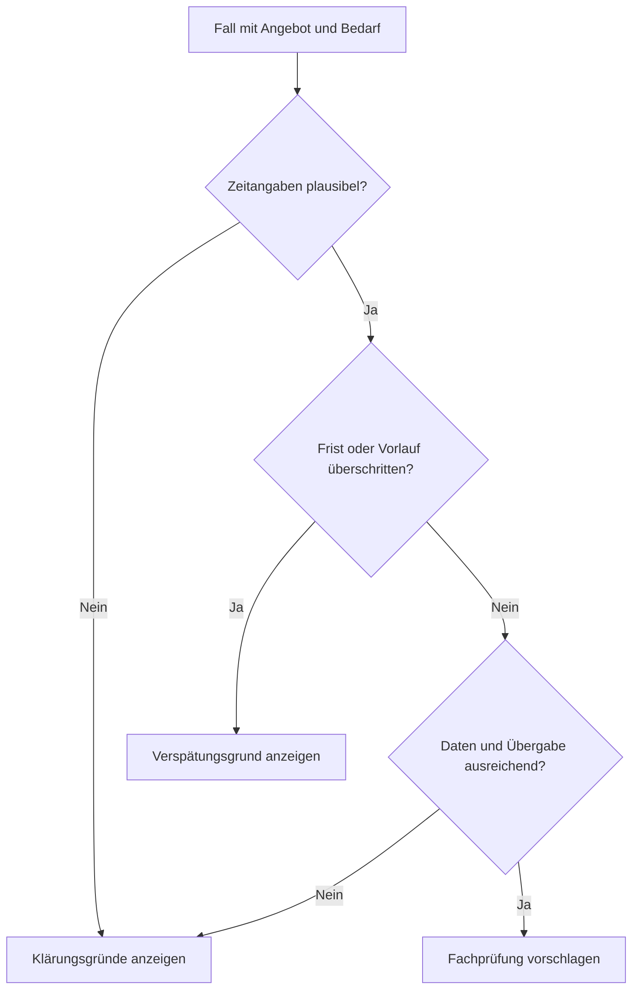

# Ergänzung zum Produktbrief · 18.11.2026 · Arbeitsentwurf

Nur für den getrennten Übernahmebranch; der bisherige Pitch-Stand bleibt gültig. Diese Ergänzung erweitert den unten unverändert übernommenen Produktbrief 0.2 aufgrund des neuen Teamauftrags zur Scan-Erfassung.

**Nutzerfall CF-SCAN-01 (Testannahme):** Eine erfassende Person im anbietenden Projekt fotografiert ein lesbares Typenschild. Sie will Hersteller, Modell/Typ, Seriennummer und Baujahr in den Bauteilpass übernehmen und ungeprüfte Vorschläge erkennen. Ein künstliches Etikett macht diesen Vorgang reproduzierbar. Ein realer Fall und der vermutete Zeitvorteil sind noch offen.

**Erwartetes Verhalten und Abnahme:**

1. Bildpixel werden lokal per OCR verarbeitet. Im Git-Quellstand sind vorher Engine und Sprachmodell bereitzustellen; das vollständige Testpaket enthält sie. Keine Ableitung von Bauteilgruppe oder Maßen allein aus dem Fotoformat.
2. Beschriftete Metadaten bleiben Vorschläge. Alle nicht leeren Angaben verlangen Einzelbestätigung, Änderungen heben sie auf. Widersprüche und ungültige Jahre werden geklärt. Leere Felder dürfen fehlen.
3. Nach Bestätigung und Speichern stehen Metadaten, Herkunft und Rohtext im Bauteilpass und bleiben nach Neuladen erhalten. Ein Etikettfoto kann bei Speicherknappheit entfallen; das wird sichtbar. Maße und Fachfreigabe bleiben getrennt.
4. Automatisierte Regeln prüfen die Speicherung und Zustandsgrenzen. Echte OCR läuft auf markierten synthetischen Bildern. Erst ein gesondert protokollierter Geräteversuch belegt Browser/Kamera-Bedienung. Erst ein Vergleich einschließlich Korrekturzeit stützt eine Zeitaussage.

Begründung: kleinster überprüfbarer Teil des gewünschten Scan-Ablaufs. Fachleute prüfen weiterhin das Bauteil und seine vorgesehene Nutzung. Kein Ersatz von A1–A5 der Zeitregel. Kein automatisch freigegebener Produktumfang, keine native App, keine Serverdatenbank und keine Veröffentlichung. Geschäftsmodell zur Erprobung: siehe Produktentscheidungen §6.

Prüfweg und Grenzen: `docs/pruefungen/uebernahme-2026-11-18.md`.

---

# CircularFlow · Produktbrief

**Fassung 0.2 · 08.11.2026 · Entwurf für den Prototyp**

Diese Fassung ergänzt den Arbeitsentwurf v0.1 auf dem Entwicklungsbranch. Die Produkthypothese und die offene Auswahl eines realen Nutzerfalls stammen aus v0.1. Die neue Fassung beschreibt den delegierten, fiktiven Simulationstest. Der Praxisfall, Zahlungsbereitschaft und Produktwirkung bleiben zu prüfen.

## Zweck und Nutzerentscheidung

CircularFlow unterstützt die frühe Koordination von Wiederverwendungsangebot und Bedarf. Der erste prüfbare Ablauf zeigt, ob eine zuständige Person nach den eingetragenen Zeitangaben einen fachlichen Prüfschritt noch anstoßen kann.

**CF-DEMO-01** ist ein fiktiver Fall. Ein Umbauprojekt in Dortmund bietet demontierbare Systemtrennwände an. Ein zweites Projekt hat einen Bedarf. Die Bauleitung auf der Bedarfsseite soll erkennen, ob sie Zustand, Maße und Nachweise rechtzeitig prüfen lassen kann. Diese Rollenannahme ist kein Praxisbefund.

## Umfang und Akzeptanz

| ID | Verhalten | Abnahme |
|---|---|---|
| A1 | Lokale Übersicht mit Fällen und Projekten | Drei vorbereitete Szenarien sind auffindbar. Ein Fall lässt sich öffnen und ein neuer anlegen. |
| A2 | Angebot und Bedarf mit Bauteiltyp, Stückzahl, Ort und Zeitfenstern | Änderungen bleiben nach lokalem Speichern und Neuladen erhalten. |
| A3 | Getrennte Zeitpunkte und Mindestprüfzeit | Bekanntwerden, Eingang, Frist und Übergabe bleiben sichtbar. Fehlende Daten erscheinen als unbekannt. Geschätzte Entscheidungswerte sind erkennbar. |
| A4 | Begründete Vorprüfung | Rechtzeitig mit passender Übergabe zeigt „Weiter prüfen“. Eingang nach Frist oder zu wenig eingetragener Vorlauf zeigt „Für diese Entscheidung zu spät“ mit dem jeweiligen Grund. Fehlende Daten und weitere Hürden werden benannt. |
| A5 | Fachliche Grenze | Fiktive Testdaten sind sichtbar gekennzeichnet. Der Vorschlag enthält einen menschlichen nächsten Schritt. Fachliche Prüfungen und Freigaben bleiben bei qualifizierten Personen. |

## Regel und Architektur

Die reine Regel in `prototype/dist/rules.mjs` rechnet mit Kalendertagen. Eingang plus Mindestprüfzeit darf auf den Fristtag fallen. Übergabe- und Annahmefenster dürfen sich an einem einzigen Tag treffen. Beides sind Annahmen für den Test. Widersprüchliche Eingaben werden vor einem zeitlichen Ergebnis geklärt. Ein belegter oder geschätzter, als verfügbar erfasster Eingang nach der Frist kann auch bei fehlenden späteren Übergabeangaben als verspätet angezeigt werden. Die Unsicherheit steht am Ergebnis. Ohne Übereinstimmung bei Typ, Stückzahl und den relevanten Fenstern bleibt Klärungsbedarf.

Eine statische Oberfläche und lokaler Browserspeicher reichen für diese Simulation. Ein gemeinsamer Datenbestand, verbindliche Reservierungen, automatische Kontaktaufnahme, berechnete Einsparungen und KI-Matching sind spätere Produktentscheidungen.

## Prüfung und Fortsetzung

`node --test prototype/test/rules.test.mjs` prüft die Regel mit fiktiven Daten. Die wesentlichen Browserabläufe sind Öffnen, Bearbeiten, Auswerten, Speichern und Wiederöffnen. Der nächste Praxisversuch prüft an einer freigegebenen Fallnotiz, wer handeln kann, welche Felder erforderlich sind und welche Vorlaufannahme gilt.

